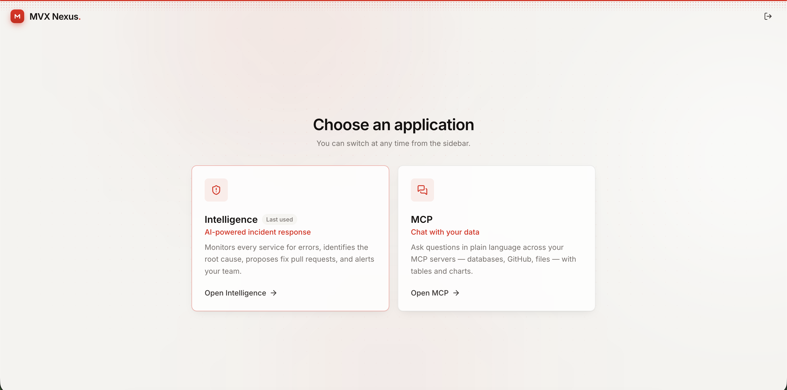
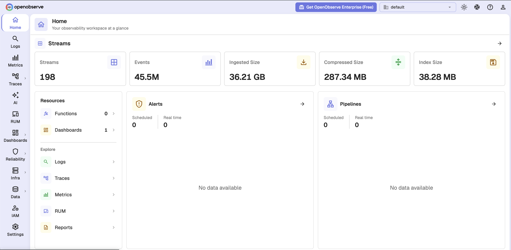
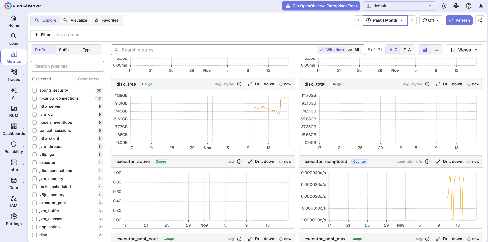
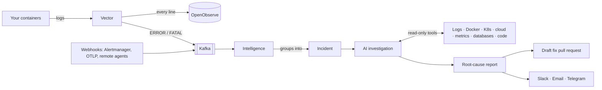

# MVX Nexus

**An open-source AI SRE and a chat-with-your-data workspace, in one self-hosted app.**

MVX Nexus watches your applications' logs, opens an incident when something breaks, has an AI
investigate the root cause with read-only access to your logs, infrastructure and code, proposes
a fix as a draft pull request, and tells your team on Slack, email or Telegram. The same sign-in
gives you a chat workspace that answers questions from your own data through
[MCP](https://modelcontextprotocol.io) servers, with tables and charts.

It runs with one command and brings its own log pipeline: [OpenObserve](https://openobserve.ai)
for log storage, [Vector](https://vector.dev) to collect logs, and [Kafka](https://kafka.apache.org)
to queue errors. Bring any AI model: Anthropic, OpenAI, NVIDIA NIM, OpenRouter, Ollama, or any
OpenAI-compatible API.

## Screenshots

**One sign-in, two apps.** After login you choose Intelligence or MCP, and switch at any time from the sidebar.



**Logs, metrics and traces from your apps land in OpenObserve** (bundled): search every log line, chart JVM and HTTP metrics, inspect traces.





## Two apps, one login

| | **Intelligence** | **MCP** |
|---|---|---|
| What it is | AI incident response | Chat with your data |
| You get | Incidents grouped from error logs, a root-cause report for each, suggested fixes, draft fix pull requests, alerts | Answers in plain language from your databases, GitHub, files and the web, with sortable tables and interactive charts |
| How | An agent that calls read-only tools: log search, Docker, Kubernetes, AWS, Azure, Prometheus, Grafana, Loki, SQL, Kafka and more | A multi-agent workflow (planner → retrievers → analyst + visualizer) that calls tools on MCP servers you connect |

Inspired by [HolmesGPT](https://github.com/HolmesGPT/holmesgpt). MVX Nexus is a separate
implementation (Spring Boot + React) with a built-in log pipeline, a web UI and MCP chat.

## How it works



1. **Collect.** Vector reads the logs of every container on the host. All lines go to
   OpenObserve; lines at ERROR or FATAL go to Kafka.
2. **Group.** Identical errors are fingerprinted into one incident with an occurrence count,
   instead of a flood of alerts.
3. **Investigate.** An AI agent looks at the surrounding logs, container and cluster state,
   metrics, databases and the code, then writes a summary, root cause, evidence and a suggested
   fix, with a confidence level.
4. **Fix.** When the cause is a code bug and confidence is high enough, it can open a **draft**
   pull request for a person to review.
5. **Notify.** The result goes to the channels you switch on.

## Quick start

You need [Docker](https://docs.docker.com/get-docker/) with Compose v2, about 6 GB of memory
for Docker, and `openssl`. Nothing else: Java and Node are not required.

```bash
git clone https://github.com/musaddique91/holms-nexus.git
cd holms-nexus
./scripts/setup.sh              # creates .env with generated passwords and prints your login
docker compose up -d --build    # first build takes several minutes
```

Open **http://localhost:8080** and sign in with the `admin` login that `setup.sh` printed
(it is also in `.env` as `HOLMES_ADMIN_PASSWORD`).

Then:

1. **Add an AI model.** Open *Settings → Models*. An *NVIDIA NIM* entry is already there: paste
   a free key from [build.nvidia.com](https://build.nvidia.com), or add Anthropic, OpenAI,
   Ollama or any OpenAI-compatible provider. Keys are stored encrypted. Both apps use this list.
2. **Pick the model for investigations.** *Intelligence → Settings → AI model*, choose the
   provider and a model that supports tool calling, and press *Test connection*.
3. **Watch it work.** Any container on this machine that logs an error now opens an incident.
   To try it: `docker run --rm --name demo-app alpine sh -c 'echo "ERROR payment failed: connection refused to db:5432"; sleep 5'`

**Incidents show "Failed" at first?** That means no AI model has a key yet (step 1). Add one;
failed incidents are retried automatically after about 30 minutes, or press *Re-investigate*
on the incident.

Port 8080 taken? Set `NEXUS_PORT` (and `HOLMES_DASHBOARD_URL`, `HOLMES_CORS_ORIGINS`) in `.env`.
OpenObserve's own UI is at http://localhost:5080 (login in `.env`).

## Monitor your apps

- **Docker on the same machine:** automatic. Nothing to configure.
- **Docker on other machines:** run the small agent in [`deploy/log-agent`](deploy/log-agent).
- **Prometheus Alertmanager:** add a webhook receiver pointing at `/api/ingest/alertmanager`.
- **OpenTelemetry:** send OTLP/HTTP (JSON) traces and logs to `/api/ingest/otlp/v1/...`.

Details and copy-paste configs: [docs/MONITOR-YOUR-APPS.md](docs/MONITOR-YOUR-APPS.md).

To let the AI read code and open fix pull requests, add each app under *Intelligence →
Services* with its repository and a GitHub or GitLab token.

## Integrations

### Getting errors in

| Source | How |
|---|---|
| Container logs (Docker) | Vector → OpenObserve + Kafka, bundled |
| Remote hosts | Vector agent → HTTPS webhook |
| Prometheus Alertmanager | Webhook |
| OpenTelemetry traces and logs | OTLP/HTTP (JSON) |
| OpenObserve alerts, custom senders | Webhook (`/api/ingest/events`) |

### Investigation tools (all read-only)

| Area | Built in |
|---|---|
| Logs | OpenObserve, Grafana Loki |
| Metrics and alerts | Prometheus, Alertmanager, Grafana |
| Traces | OpenTelemetry (trace lookup, error-trace search) |
| Containers and orchestration | Docker, Docker Compose, Kubernetes (`kubectl`) |
| Cloud | AWS (CloudWatch logs and alarms, ECS, EC2, RDS, load balancers), Azure (App Service, Container Apps, AKS, activity log, Log Analytics) |
| Databases | PostgreSQL, MySQL / MariaDB, SQL Server, MongoDB |
| Messaging | Kafka, RabbitMQ |
| Code | GitHub, GitLab (recent commits, diffs, files, pull requests, pipelines) |

Docker and Compose are on by default; switch the others on in `.env` (see
[Configuration](#configuration)). Databases, Kafka clusters, MongoDB and RabbitMQ are listed in
`config/holmes.yml`.

### Fixes and alerts

| | |
|---|---|
| Fix pull requests | GitHub and GitLab, as drafts, with a per-service or global token |
| Notifications | Slack (webhook or bot), Email (SMTP), Telegram (including forum topics) |

### AI models

Anthropic, OpenAI, Ollama, and any OpenAI-compatible API: NVIDIA NIM, OpenRouter, Google Gemini
(OpenAI endpoint), vLLM, LiteLLM and others. Investigations need a model with tool calling.

### MCP servers (for the MCP chat app)

Connect any MCP server over stdio (`npx`, `uvx`, Docker), Streamable HTTP or SSE, or install one
from the built-in catalog in a click:

- **Data:** PostgreSQL, MongoDB, Elasticsearch, SQLite, Redis
- **Developer:** GitHub, Sentry, CircleCI, Linear, Figma, Docker, DeepWiki, Context7
- **Knowledge:** Notion, Asana, AWS Knowledge, Microsoft Learn, Hugging Face, Shopify Dev
- **Mail:** Gmail, Outlook, Yahoo, any IMAP/SMTP mailbox
- **Web:** Fetch, Brave Search, Tavily, Perplexity, Firecrawl, Playwright, Puppeteer

You can also import a Claude Desktop or Cursor `mcpServers` JSON file.

### Not built in yet

Compared with HolmesGPT's integration list, these are **not** available as Intelligence
investigation tools today: Google Cloud, Datadog, New Relic, OpenSearch / Elasticsearch,
Grafana Tempo, Coralogix, ArgoCD, Helm, Jira, PagerDuty, OpsGenie, ServiceNow and Confluence.
Some of them (Elasticsearch, Sentry, Notion, Linear) can be queried from the **MCP chat app**
through a catalog server, but automatic investigations do not use MCP servers yet.
Contributions are welcome: see [CONTRIBUTING.md](CONTRIBUTING.md).

## Configuration

Everything is in `.env` (created by `setup.sh` from [`.env.example`](.env.example), which
documents every setting). Restart the backend after a change: `docker compose up -d backend`.

| Setting | What it does |
|---|---|
| `HOLMES_ADMIN_USERNAME` / `HOLMES_ADMIN_PASSWORD` | The sign-in |
| `HOLMES_JWT_SECRET` | Signs sessions and encrypts saved API keys. Back it up |
| `HOLMES_DASHBOARD_URL`, `HOLMES_CORS_ORIGINS` | The address you open in the browser |
| `NEXUS_PORT`, `NEXUS_BIND` | Where the UI listens (`127.0.0.1:8080` by default) |
| `HOLMES_MAX_PER_HOUR`, `HOLMES_CONCURRENCY` | Limits on automatic investigations, to cap AI cost |
| `HOLMES_WEBHOOK_TOKEN` | Shared secret for the ingest webhooks |
| `GITHUB_TOKEN`, `GITLAB_TOKEN` | Global tokens for reading code and opening fix pull requests |
| `HOLMES_KUBERNETES_ENABLED`, `HOLMES_AWS_ENABLED`, `HOLMES_AZURE_ENABLED` | CLI toolsets (mount a kubeconfig or provide cloud credentials) |
| `PROMETHEUS_*`, `GRAFANA_*`, `LOKI_*`, `OTEL_*` | Observability toolsets |
| `OPENOBSERVE_RETENTION_DAYS` | How long logs are kept (7 days by default) |

Models, notification channels, services and MCP servers are managed in the UI and stored in the
database.

## Running it for real

- **HTTPS:** put a reverse proxy with TLS in front; see
  [`deploy/nginx/example.conf`](deploy/nginx/example.conf). Keep `NEXUS_BIND=127.0.0.1`.
- **Back up** the `postgres_data` volume and your `.env`. Losing `HOLMES_JWT_SECRET` makes saved
  API keys unreadable.
- **Upgrade:** `git pull && docker compose up -d --build`. Database migrations run on start.
- **Logs and status:** `docker compose ps`, `docker compose logs -f backend`.
- **Stop:** `docker compose down` (add `-v` to also delete all data).

## Security

The AI's tools are read-only, Docker access goes through a GET-only proxy, saved secrets are
encrypted, and fix pull requests are drafts limited in size and scope. MVX Nexus still holds
access to your logs, infrastructure and code, so keep it private and behind HTTPS. Read
[SECURITY.md](SECURITY.md) before exposing it, and report vulnerabilities privately as
described there.

## Project layout

| Path | What |
|---|---|
| `backend/` | Spring Boot 4 (Java 25): API, ingestion, investigations, MCP, Liquibase migrations |
| `frontend/` | React 19 + Vite + Tailwind 4 |
| `deploy/vector/` | Vector config used by the bundled stack |
| `deploy/log-agent/` | Vector agent for other machines |
| `deploy/nginx/` | HTTPS reverse-proxy example |
| `config/holmes.example.yml` | Optional settings: databases, Kafka, MongoDB, RabbitMQ, seed services |
| `docs/` | [Intelligence architecture](docs/INTELLIGENCE-ARCHITECTURE.md), [MCP architecture](docs/MCP-ARCHITECTURE.md), [monitoring guide](docs/MONITOR-YOUR-APPS.md) |

## Contributing

Issues and pull requests are welcome. See [CONTRIBUTING.md](CONTRIBUTING.md) for the
development setup and how to add an integration.

## License

[MIT](LICENSE)
