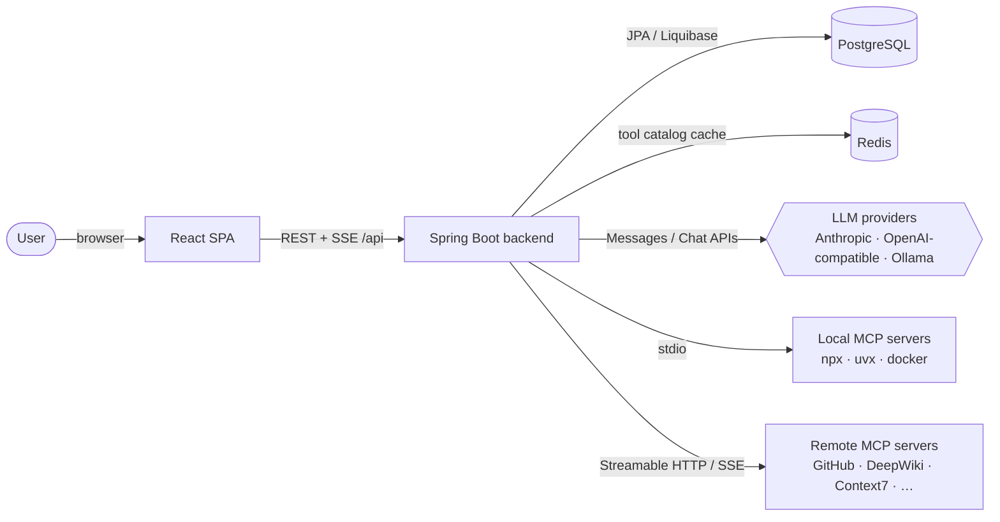
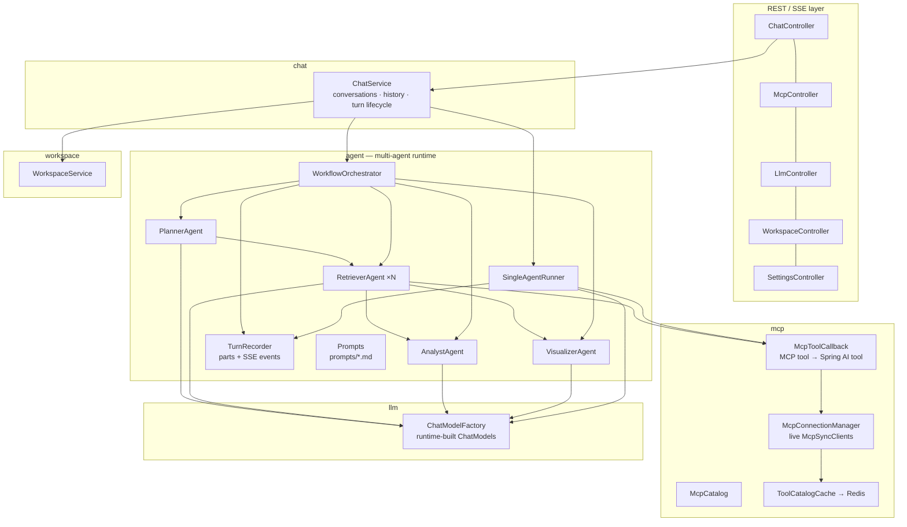
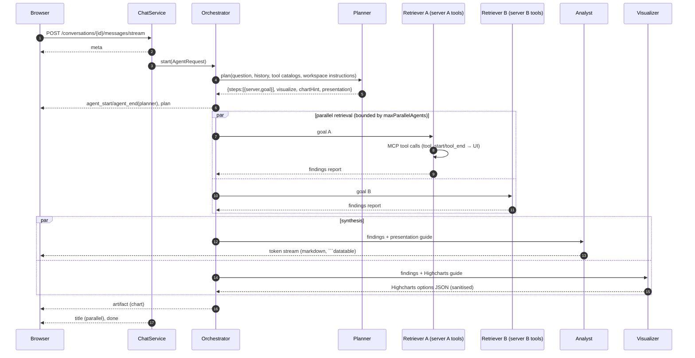
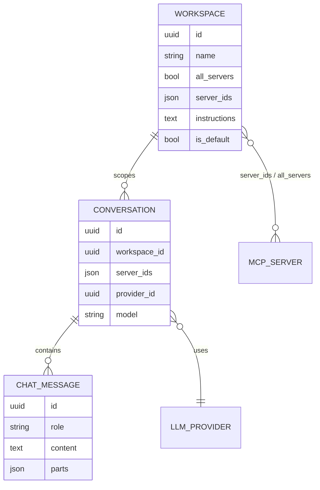

# Nexus MCP — System Design

Nexus lets people talk to their data. Any number of **MCP servers** (databases, SaaS APIs, files, infra) are
grouped into **workspaces**; each question is answered by a **team of agents** that plan, fetch real data through
MCP tools in parallel, analyse it and present it as narrative, rich tables and interactive Highcharts charts.

Design goals:

1. **Integration-agnostic** — no server-specific code. Agents only see what MCP servers advertise (tools, schemas,
   instructions), so a new integration works the moment it connects.
2. **Transparent** — every agent, tool call, argument, result and timing streams to the UI live.
3. **Presentation-grade output** — data arrives as sortable/exportable tables and charts you can re-type, view in
   3D and export as PNG / JPEG / SVG / PDF / CSV / XLS.
4. **Self-hosted & model-agnostic** — Anthropic, any OpenAI-compatible endpoint, or local Ollama, chosen per chat.

---

## 1. System context



## 2. Backend components



| Package | Responsibility |
|---|---|
| `mcp` | Server registry (DB), live connections (stdio / Streamable HTTP / SSE), tool/resource/prompt discovery, catalog, Claude-Desktop JSON import/export, explorer API. |
| `agent` | Planner, retrievers, analyst, visualizer, orchestrator, single-agent fast path, prompt templates, `TurnRecorder`. |
| `chat` | Conversations, message persistence, history with data context, SSE turn lifecycle, cancellation, auto-titles. |
| `workspace` | Named server groups + per-workspace instructions; default "All servers" workspace. |
| `llm` | Provider settings, model discovery, `ChatModelFactory` (no auto-config — keys change without restart). |
| `settings` | System prompt, temperature, max tokens, agent mode, visualizer, parallelism. |

## 3. The multi-agent workflow



**Agents**

| Agent | Input | Tools | Output |
|---|---|---|---|
| Planner | question, last 6 turns, every attached server's tool catalog (name + description), workspace instructions | none | JSON plan. Invalid JSON → *fallback plan* (ask every server). |
| Retriever ×N | one plan step + the overall question | **only its server's tools** | factual report: summary, data as JSON/markdown, caveats |
| Analyst | system prompt, history, question, all findings, presentation guide | none | streamed answer with ```datatable blocks |
| Visualizer | question, chart hint, findings, Highcharts catalog | none | one Highcharts options object (or `{"skip": …}`) |

**Why this shape:** retrievers are isolated per server, so a big catalog never floods one context and servers are
queried concurrently; the planner sees only short tool descriptions; the analyst never sees raw tool schemas;
the visualizer runs *in parallel* with the analyst so charts add no latency to the text.

**Single-agent mode** (Settings → Preferences) keeps one agent with all tools and both presentation guides — fewer
model calls, better for small local models.

## 4. Streaming protocol (SSE)

| Event | Payload |
|---|---|
| `meta` | provider, model, workspace, mode, toolCount |
| `agent_start` | `{id, role, name, goal, serverId?, server?, startedAt}` |
| `plan` | `{intent, steps[], visualize, chartHint, presentation, fallback}` |
| `tool_start` / `tool_end` | `{id, agentId?, server, tool, args}` / `{id, agentId?, status, result, durationMs}` |
| `agent_end` | `{id, status: ok\|error\|skipped, summary, output, durationMs}` |
| `token` | `{text}` (analyst / single agent) |
| `artifact` | `{type:"chart", id, title, options}` |
| `title` | `{title}` (generated in parallel on the first turn) |
| `error`, `done` | terminal |

The same structure is persisted as ordered **message parts** (`workflow`, `text`, `tool`, `chart`), so a reloaded
conversation renders exactly what streamed.

## 5. Presentation layer ("training" the agents)

Agents learn formats from versioned prompt files in `backend/src/main/resources/prompts`:

- `highcharts.md` — chart-selection matrix covering line/spline/area, column/bar, stacked & percent, pie/donut,
  combo dual-axis, scatter/bubble, boxplot, ranges, heatmap, treemap/sunburst, sankey/dependency wheel,
  funnel/pyramid, gauges, waterfall, polar/radar, xrange, wordcloud, item, packed bubble, streamgraph and 3D, plus
  data-shape rules and quality rules.
- `presentation.md` — the `datatable` spec: typed columns (`text, number, currency, percent (+trend), date,
  datetime, badge, progress, link, code`), totals, limits.

Frontend renderers:

- **HighchartsBlock** — all modules loaded (more, 3d, heatmap, treemap, sunburst, sankey, dependency-wheel, funnel,
  solid-gauge, wordcloud, xrange, variwide, streamgraph, item, drilldown, exporting, offline-exporting, export-data).
  Toolbar: chart-type switcher (category ↔ pie conversion, stacking, donut), 3D toggle with drag-to-rotate,
  data-table view, export PNG/JPEG/SVG/PDF/CSV/XLS, fullscreen, copy JSON. Theme derived from CSS tokens.
- **DataTable** — sorting, filter, pagination, typed formatting, totals footer, CSV export, copy (TSV), and
  "Chart this" (turns any table into a Highcharts chart).

Model-generated options are **sanitised** (backend and frontend): `events`, `formatter*`, `positioner`, `useHTML`,
`exporting`, `credits` and any functions are stripped.

## 6. Workspaces



The top-bar switcher selects the active workspace; the sidebar lists that workspace's chats; the composer offers
only its servers; its instructions are injected into every agent.

## 7. Integration-agnostic MCP handling

- Transport abstraction: `STDIO` (process with enriched PATH), `STREAMABLE_HTTP`, `SSE`, custom headers/env.
- Discovery at connect: `initialize` → `tools/list` (paginated) → resources/prompts if advertised; `tools/list_changed`
  notifications update the catalog live; catalogs are cached in Redis for offline display.
- Tool exposure: each MCP tool becomes a Spring AI `ToolCallback` named `<server-slug>__<tool>` (≤ 64 chars, unique),
  described as `[Server] description`, with the server's JSON schema. Errors are returned to the model as text so
  it can recover.
- Server `instructions` from `initialize` are passed to agents.
- Three ways in, one behaviour: the curated catalog (~54 tested entries incl. Gmail/Yahoo/Outlook over IMAP,
  Portainer, Docker, Stripe, HubSpot, OAuth-bridged Linear/Jira/Sentry/Asana via `mcp-remote`), the **public
  registry** tab (live search of registry.modelcontextprotocol.io — remote, npm, PyPI and OCI entries are mapped to
  a server config by `McpRegistryService`, with a form for required env vars/headers/arguments), and custom
  servers / Claude-Desktop JSON import. Everything gets the full workflow, tables and charts.

## 8. Reliability, security, performance

| Concern | Approach |
|---|---|
| Cancellation | `stop` disposes the analyst stream and interrupts retriever futures; partial answers are saved. |
| Timeouts | MCP requests 90 s, init 120 s; retrievers 6 min; visualizer 4 min; SSE 30 min. |
| Failure isolation | A failing retriever marks its card red; analysis continues with the other findings. |
| Secrets | Provider keys never leave the backend (UI sees a hint); MCP env/headers stored server-side. |
| Output safety | Highcharts options sanitised; markdown rendered without raw HTML. |
| Concurrency | Virtual threads; per-turn semaphore (`maxParallelAgents`). |
| Context size | Planner sees trimmed catalogs (≤ 14k chars); findings truncated (20k each); history keeps compact traces of earlier retrieved data for follow-ups. |
| Scaling | Stateless REST + sticky sessions for SSE/MCP connections (K8s Service ClientIP + ingress cookie). |

## 9. Extension points

- **New agent role**: add a class in `agent/`, a prompt in `prompts/`, call it from `WorkflowOrchestrator`, and add
  a role to `AgentRole` and the UI `ROLE` map.
- **New model provider**: add a `ProviderType` and a branch in `ChatModelFactory`.
- **New presentation block**: teach it in `presentation.md`, render it in `Markdown.tsx` → `RichBlock`.
- **New catalog server**: one `Entry` in `McpCatalog`.
